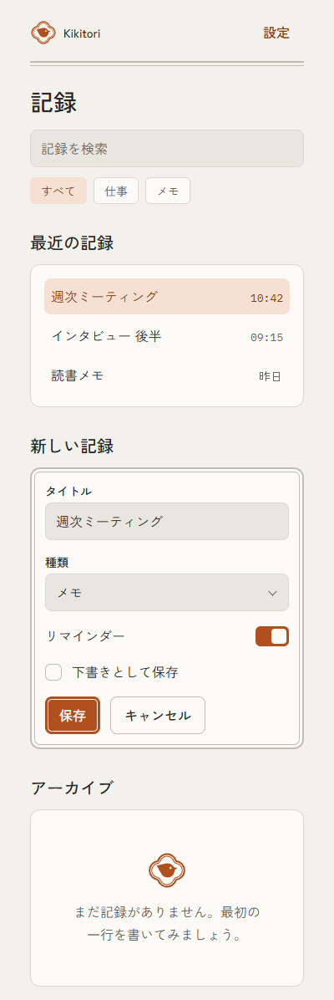

# kamon-react

The kamon brand for React apps on the web and in Tauri: the tokens as CSS and TypeScript, the UI elements in `ui/ui.css`, React components built on them, the logos and app icons, and the `brand-ui` skill that teaches coding agents the brand's rules.

The brand itself, its tokens, logos and rules, lives in `kamon-brand`, which explains the ideas behind it. This kit is built from a pinned version of that base (recorded in `base.json`), and apps install this kit, never the base.

<p>
  
  &nbsp;
  
</p>

## Using it in an app

Apps install the kit pinned to a version tag, so the kit can move on without changing any app until that app upgrades.

1. **Install it, pinned.** In the app's `package.json`:

   ```json
   "dependencies": { "@yusai/kamon-react": "git+https://github.com/yusaitajiri/kamon-react.git#v1.0.0" },
   "scripts": { "postinstall": "brand-sync" }
   ```

   Then run a plain `npm install` or `pnpm install`. Installing with a package name (`npm install @yusai/kamon-react`) skips the app's own `postinstall`, so run the plain install once after adding the line. The built components are committed in `dist/`, so installing builds nothing.
2. **`brand-sync` runs after every install.** It copies the `brand-ui` skill into `.claude/skills/brand-ui/` and adds that folder to `.gitignore`. Claude Code doesn't look for skills inside `node_modules`, so this copy is what makes the skill visible. Redoing it on every install keeps it on the pinned version.
3. **Point Claude Code at the skill.** Add this line to the app's `CLAUDE.md` (or `AGENTS.md`):

   ```text
   For any UI work, use the brand-ui skill: it has the kamon brand rules for this app.
   ```

   Other coding agents don't read Claude Code skills, so point them at `.claude/skills/brand-ui/SKILL.md` in their own instruction file.
4. **Set up the page once.** Import the styles at the app's entry, and put the app's id on `<html>`:

   ```tsx
   import "@yusai/kamon-react/tokens/tokens.css";
   import "@yusai/kamon-react/ui/ui.css";
   ```

   ```html
   <html lang="ja" data-app="kikitori">
     <body class="ui">
   ```

   The brand's own pages need no `data-app`; their accent is moss. Dark mode follows the system; `data-theme="light"` or `"dark"` on `<html>` overrides it.
5. **Build with the components.**

   ```tsx
   import { Button, Card, Field, Input, Rule } from "@yusai/kamon-react";

   <Rule />
   <Card frame>
     <Field label="タイトル" error={error}>
       <Input value={title} onChange={(e) => setTitle(e.target.value)} />
     </Field>
     <Button variant="primary" type="submit">保存</Button>
   </Card>
   ```

6. **App icon.** For Tauri, point `tauri icon` at `node_modules/@yusai/kamon-react/icons/<app>/icon-1024.png`, then replace the `.ico` it writes with the kit's `icon.ico`, which draws the small sizes properly. Icons generated into the app are part of its build, so commit those.
7. **Upgrade on purpose.** Change the tag (`#v1.1.0`) and install again. `CHANGELOG.md` says what changed between the two versions and what the app needs to do. An agent can carry it out: "Upgrade @yusai/kamon-react from v1.0.0 to v1.1.0, following its CHANGELOG."

## The components

Each component renders the matching element of `ui/ui.css`, so a page built from them looks exactly like one written with the classes, and the classes stay available for anything the components don't cover.

| Component | What it is |
| --- | --- |
| `Button` | Secondary by default. `variant="primary"` is the one accent-filled action per view, with the thin inner line that comes from the 木瓜 frame's double outline; `"quiet"` stays out of the way in toolbars and rows. |
| `Field`, `Input`, `Select` | A label over a text box or select, with help or an error under it. An error is always in words, and the Field marks the control invalid for screen readers. |
| `Checkbox`, `Switch` | With their labels. The switch's track is squared, not a pill. |
| `Card` | A raised card with a hairline border. `frame` gives it the kamon's frame, for the one container you're working in. |
| `List`, `ListRow` | Rows with an optional mono value at the end, and a selected state in the app's tint. |
| `Tag` | A small label or filter, with a pressed state. |
| `EmptyState` | One sentence, optionally under the app's logo. |
| `Rule` | 子持ち罫, the thick-over-thin line, once under the app bar. |
| `Logo` | The app's logo from `logo/`, in its color and its dark-mode color, with the small drawing below 32px. |

Values for code, such as a canvas or a chart, come from `@yusai/kamon-react/tokens`: `brand` holds every value and `appColors("kikitori", "dark")` returns the colors with `accent` set to the app's own.

The demo pages show every component and two sample screens: `npm install`, then `npm run demo` and open the address it prints. `ui/screens/` has them in light and dark.

## Files in this kit

| File or folder | What's inside |
| --- | --- |
| `src/` | The components, and `tokens.ts` and `logos.ts`, which are generated. |
| `dist/` | The components built for apps, committed so a git install needs no build. |
| `tokens/tokens.json` | Copied from `kamon-brand`: the source of truth, with a usage note on every token. |
| `tokens/tokens.css` | CSS custom properties generated from `tokens.json`. Light by default, dark through the system setting or `data-theme="dark"`, and `data-app` picks the accent. |
| `ui/ui.css` | The UI elements built on the tokens, with the kamon's double line: the primary button's inner line, `.frame` and `.rule`. `ui/screens/` has the demo pages in light and dark. |
| `logo/`, `icons/` | Copied from `kamon-brand`: every app's logo and its app icons. |
| `rules/brand.md` | Copied from `kamon-brand`: the brand's rules for every platform. |
| `skill/react.md` | How to apply the rules in React. |
| `skills/brand-ui/SKILL.md` | The skill apps get: `rules/brand.md` followed by `skill/react.md`, generated. |
| `base.json` | The `kamon-brand` version this kit was built from. |
| `scripts/` | `sync-base.mjs` copies from `kamon-brand` and runs `generate.mjs`, which writes the generated files. `brand-sync.mjs` copies the skill into an app. |
| `demo/` | The demo pages, built from the components with Vite. |
| `CHANGELOG.md` | What changed in each version and what an app has to do to upgrade. |
| `LICENSE`, `TRADEMARKS.md` | MIT for the style and code; the logos, icons and names are reserved. |
| `AGENTS.md` | Instructions for agents working on the kit: syncing, building and releasing. |

## Changing the kit

`AGENTS.md` has the steps. Changes to the brand itself, a color, a logo or a rule, are made in `kamon-brand` and released there first; this kit then syncs to the new tag and releases. Changes to how React applies the brand, the components, `ui.css` or `skill/react.md`, are made here.

## License

The style is open and the identity is reserved. The tokens, `ui.css`, the components, the skill, the scripts and the text of these docs are under the MIT License. The logos, the app icons and the apps' names, such as Kikitori, are all rights reserved. `LICENSE` has the terms, and `TRADEMARKS.md` says how to refer to the names and logos.
