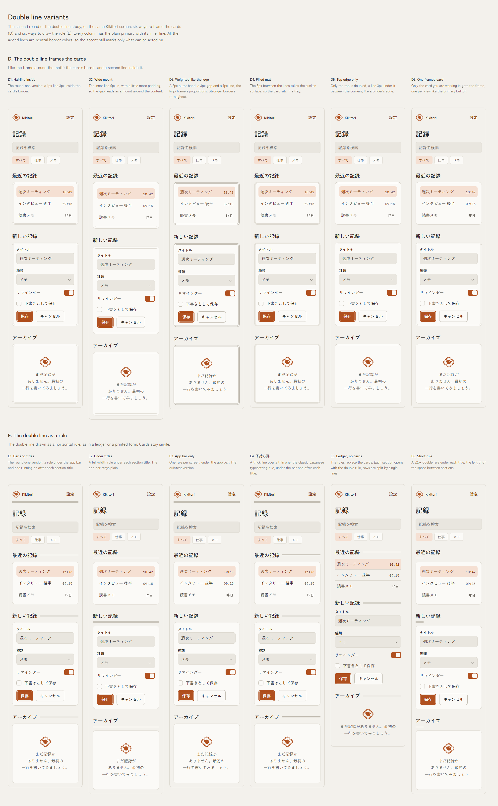
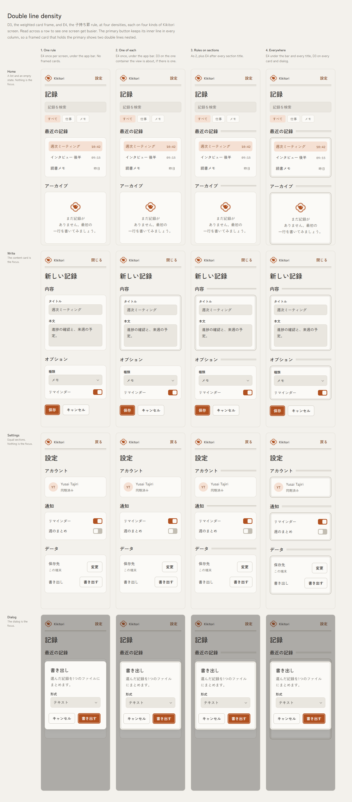
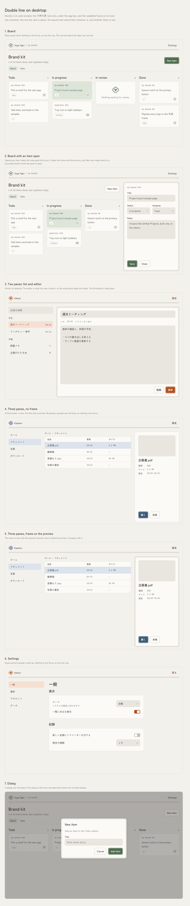

# Direction: the double line instead of the notch

Status: adopted 2026-10-18, with density 2 (one rule, one frame and one primary per view) as the recommended default rather than a hard rule. `ui/ui.css` draws the three forms (`.button-primary`, `.frame`, `.rule`), and the rules are in `AGENTS.md` and `README.md`. This page records the studies behind them. The notch from `direction-kamon-ui.md` is retired.

## The idea

The 木瓜 frame has two details: the notch where the lobes meet and the double line that follows them. The notch only works on one element and reads as a ticket or a cloud when it spreads. The double line is plainer. It is also the more authentic of the two, since the classic crest is drawn as a double outline. So the kamon reaches the UI through the double line alone, in three forms:

- **The primary button**: the plain `radius-md` button with a 1px line 3px inside it, in `on-accent`. No notch.
- **D3, the frame**: a card with a 2px outer band, a 3px gap and a 1px line, the logo frame's proportions (6, 3, 3 on the 140 grid), in `border-strong`.
- **E4, 子持ち罫**: a horizontal rule, a 2px line over a 1px line with 3px between, in `border-strong`.

The frame and the rule are neutral, never `accent`. The accent still marks only what can be acted on.

## How the forms were chosen

1. `kamon-ui/double-line.html` put five versions of one Kikitori screen side by side: the notch, the double line on the primary only, the double line marking active states, on cards (D) and as a rule (E). D and E went on.
2. `kamon-ui/double-line-variants.html` drew six versions of each. D3 (weighted like the logo) and E4 (子持ち罫) were chosen. D3 is the most clearly the crest, and it is the one frame that stays visible in dark mode. The hairline versions (D1, D6) nearly vanish on dark `border`.

## What the sources say about density

Few sources cover how sparingly 子持ち罫 or double frames should be used. These do agree:

- **Rules support the content and shouldn't compete with it.** Adobe Japan's guide to rule lines says to keep them thin, to remove the ones you don't need, and to let white space separate where it can. It describes 子持ち罫 as making a hierarchy through the contrast in weight ([Adobe](https://www.adobe.com/jp/creativecloud/roc/blog/design/quiz-challenge/rule-line.html)).
- **The thick line goes outside or on top** ([DDC printing glossary](https://www.ddc.co.jp/words/archives/20260824173237.html)). A rule with a direction marks the top of something, so it belongs at the top of the screen and loses its meaning when it repeats.
- **Spacing first, and no lines inside a container.** Design systems say not to use a divider where margin already separates, and not inside cards, tiles or dialogs, which already separate their content ([Volvo](https://designsystem.volvocars.com/web/components/divider/usage/), [Toyota](https://dx-playbook-prev.toyota-europe.com/cds/components/divider/)). Borders used to group everything become noise that competes with the content ([Andrew Coyle](https://coyleandrew.medium.com/8-rules-to-help-you-design-a-better-card-user-interface-a239257d633d)).
- **A crest is a seal**, which `direction-kamon-ui.md` already found: the kamon works where there is one of something in a view.

These are practitioner guides, not measured studies.

## The density study

`kamon-ui/double-line-density.html` puts D3 and E4 at four densities on four kinds of screen: a home list, a write screen with a content card, settings with equal sections, and a dialog.

| Density | What it does | How it reads |
|---|---|---|
| 1. One rule | E4 under the app bar, nothing else | Calm. The logo and the rule sit together at the top edge. |
| **2. One of each** | E4 under the app bar, D3 on the one container the view is about | Calm, and the frame points to where the work is: the content being written, or the dialog. Home and settings have no such container, so they look the same as 1. |
| 3. Rules on sections | As 2, with E4 after every section title | Too much. Each rule lands right above a card's top edge, stacking four lines in about 25px, and on the write screen the rules compete with the frame. |
| 4. Everywhere | E4 on every title, D3 on every card | A form full of boxes. Nothing stands out, and the dialog's frame merges with the frames behind it. |

## Recommended density: one rule, one frame, one primary

Density 2 is the recommended default, not a law: an app may go lighter, for example with the rule and no frame. What it should not do is go denser, toward densities 3 and 4. A view here is everything in front of the user at once, an open dialog or panel included.

Where each form may go, at any density:

- **E4 only under the app bar**, next to the logo at the top edge. Never after section titles: sections are separated by space and their headings. A divider inside content stays a plain 1px `border`.
- **D3 only on a container you are working in**: where you write, edit or confirm. That is an editor, an edit panel, a dialog or a sheet. A preview, an inspector or a details pane only shows the selection, so it stays plain even when it holds the primary. Never on list rows, repeated items, nested cards or small elements.

The recommendation, per view:

- **One rule** under the app bar.
- **One frame** on the container being worked in. Views of equal sections (home, boards, settings, lists, browsers) get none.
- **One primary**, which is already a rule of the kit.

And the limits that hold whatever the density:

- **Never two frames in one view.** When a panel or dialog opens to edit something, the frame and the primary move to it: the page under it drops its frame, and its primary steps down to a secondary button, while it is open.
- **The primary button keeps its inner line**, inside the frame or outside it. Both read well.
- **The rule and the frame never touch.** There is always a heading or at least `space-6` between them.
- **A dialog keeps `shadow-float` with its frame.** It floats, so it has both.

Decided after the density study: E4 goes under the app bar, not the page title, and a framed dialog keeps its float shadow. The two depth cues are not too much.

## On desktop

`kamon-ui/double-line-desktop.html` puts density 2 on seven wide layouts: the project board, the board with an item open in a side panel, Kikitori with a list beside an editor, Explorer's three panes with and without a frame on the preview, settings with a side nav, and a dialog over the board.

- **The rule holds at full width.** On the board it sits above the tabs' own 1px line with the page title between them, and the two don't read as a pair.
- **The frame holds at any size.** Its weights are fixed pixels, so a 820px editor pane looks as calm as a phone card. It does not get heavier as it grows.
- **Equal layouts need no frame.** The board, settings and the file browser look finished with only the rule. On the board the frame first appears when an item opens, which makes the panel read as where the work moved.
- **A frame on a preview pulls the eye the wrong way.** In Explorer the work is browsing the file list, and framing the preview beside it made the side pane the loudest thing on screen. That led to the "working in, not showing" test above.
- **The panel's first draft started right under the rule**, and the two read as one stack of lines. Starting it level with the page title, `space-6` below the rule, fixed it.

## Native apps

The inner line, the frame and the rule are for the web and the brand's own desktop UI, as the notched button was. iOS and Windows keep their own buttons and containers, tinted with `accent`.
