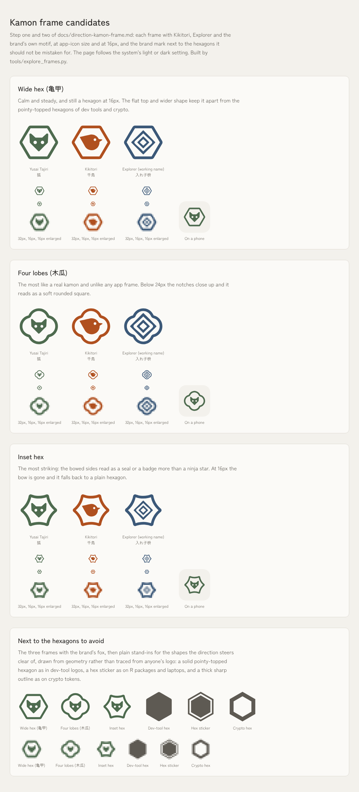
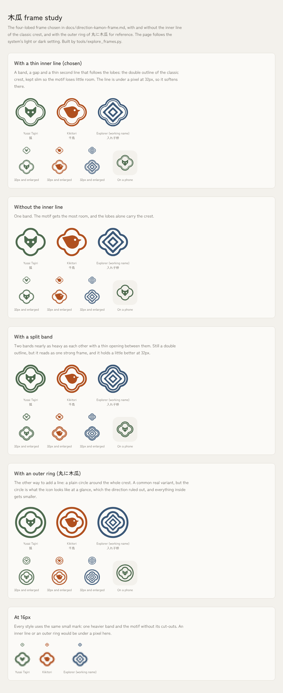

# Direction: a kamon-inspired frame for every app

Status: adopted 2026-10-17. Every logo and icon in the kit is now the 木瓜 frame with the app's motif inside, drawn by `tools/build_logo.py`; the snake system is retired. This page is the record of how the frame was chosen.

## What I want

- Keep the UI itself mostly standard. The brand should be subtle, not completely original.
- Still have a recognizable family across apps, the way Adobe's apps look like tiles in a periodic table: one shared frame, one color and one symbol per app.
- The look is **clean and polished**. It is **not** neon, flashy, too visual or cluttered.

## What I ruled out and why

- **The snake as the system.** A character is a topping, not part of the design. Shelved for now.
- **Brand inside the UI** (thermography, fractals, a single "snake line" through the layout). Interesting, but more than I want the UI to carry.
- **Simulation and pixel looks** (particles, falling sand, ink, dithering, ASCII). Not clean; small per-pixel color doesn't fit a modern UI.
- **Gems and minerals.** They look alike in outline, so apps would differ by color only, and facets push toward gradients and shine.
- **A plain circle.** It makes the icon look like any other app.

## The direction

Take the structure of **kamon (家紋)**, a simple motif inside a frame, flat and one color, without the formality:

- Thicker strokes with rounded joins instead of thin, sharp lines.
- Each motif reduced to 3–5 simple shapes.
- The app's own accent color (the palette is already Japanese traditional colors: moss, shu, ai, budo, tetsu).
- The current app motifs already fit, because they are classic crest designs: 千鳥 (Kikitori), 入れ子枡 (Explorer), 狐 (the brand itself). The snake body goes; the heads stay as the motif.

## Frame shape: the open decision

Three candidates, all one frame shared by every app:

| Frame | Notes |
|---|---|
| **Wide hex (亀甲)** | A flat-topped hexagon a little wider than tall, like a nut. The direct kamon origin, and the least like Node.js, R hex stickers or crypto logos. |
| **Four lobes (木瓜)** | Very distinctive and soft. Almost no software uses it. |
| **Inset hex** | A hexagon with sides curved inward. Most striking of the three, but it risks reading as a ninja star or a crypto token, so check that carefully. |

Other shapes considered: rounded hex, open hex (gap in one side), double hex (二重亀甲), octagon (八角), notched square (隅入り角), shogi piece (駒), leaf square, one sharp corner, arch.

### Hexagons already in use

No consumer app family owns the hexagon, but it carries two associations: developer tools (R package stickers, Node.js, GraphQL, laptop stickers) and crypto (Chainlink, Polygon). Wider proportions, softer corners and muted traditional colors keep it away from both.

### Platform note

iOS and Android mask app icons to a rounded square or circle, so on phones the frame sits inside that mask on `surface` or a tint. Windows, macOS, the web and in-app marks can show the frame on its own.

## What the drawings show

Steps 1 and 2 were drawn with an exploration script, `tools/explore_frames.py`, since retired (it is in the git history). The first round's comparison sheet is kept as `docs/kamon-frames/candidates-light.png` and `candidates-dark.png`. Each mark is one filled path on the logos' 140 grid: a 9-unit ring with the motif fitted at least 7 units inside it, and for 24px and down a heavier 14-unit ring, a 9-unit gap and the motif without cut-outs.

- **Wide hex** stays a hexagon down to 16px. Next to the dev-tool, sticker and crypto stand-ins the flat top and the motif keep it apart, but at 16px it is the closest of the three to them.
- **Four lobes** is the most like a real kamon and looks like no app frame at full size. Below 24px the notches close up and it reads as a soft rounded square, which is still distinct but loses what makes it special.
- **Inset hex** reads more as a seal or a bottle cap than a ninja star or a token. At 16px the bow disappears and it becomes a plain hexagon, so it costs the most and keeps the least at small sizes.
- **The motifs.** The fox and the boxes carry over as they are. The plover's wing line had to go: inside a frame it sat under the eye like a smile. 入れ子枡 stays turned 45°, and in the hexagons that makes it the smallest motif, because its corners point at the flat sides.
- **At 16px the frame does most of the work.** The motif is about 5px and reads as a blob of the app's color, so telling apps apart there rests on color, as it already does with the snake.

Lean: the wide hex for the calmest, most legible family, or four lobes if being unmistakably kamon matters more than the 16px shape. The inset hex is the weakest at small sizes.

**Chosen: four lobes (木瓜).** Four is the standard 木瓜 crest. Five lobes (五瓜, as in 織田木瓜) reads as a plum or cherry blossom inside a frame, and three as a clover or a playing-card club, so both lose the plain-frame quality the family needs.

## The 木瓜 frame

**Chosen: a thin inner line, kept slim for the motif.** The frame is four circles of radius 35, set so the whole is 128 wide and 120 tall on the 140 grid, with the notches 48 from the centre and rounded to 3. From the outside in it is a 6-unit band, a 3-unit gap and a 3-unit line that follows the lobes, and the motif sits at least 5 inside that line. For 24px and down it drops to one 14-unit band with a 9-unit gap and the motif without cut-outs.

The ways to draw its line were compared on one sheet, kept as `docs/kamon-frames/line-styles-light.png` and `line-styles-dark.png`:

How big each motif can be on the 140 grid, its longest side:

| Line | Fox | Plover | Boxes |
|---|---|---|---|
| No inner line (one 8-unit band) | 54 | 81 | 94 |
| **Thin inner line (6, 3, 3), chosen** | 48 | 71 | 86 |
| Split band (7, 3, 6) | 42 | 60 | 77 |
| Outer ring (丸に木瓜) | smaller still: the whole crest shrinks to 0.8 | | |

- The inner line is the authentic detail: classic 木瓜 is drawn as a double outline. A line outside is the separate 丸に木瓜 variant, which makes the icon read as a circle, so it is out.
- Rounder lobes give the motif more room, because its corners run into the notches; deeper notches cost it. Radius 35 is the balance.
- At 32px the inner line is under a pixel and softens. At 16px no line shows either way.

## Next steps

1. ~~Draw the three candidate frames with Kikitori, Explorer and the brand motif inside, at app-icon size and at 16px, in light and dark.~~ Done, see above.
2. ~~Put them next to Node.js, an R hex sticker and a crypto hex logo to make sure the winner reads as none of them.~~ Done with plain stand-ins drawn from geometry, see above.
3. ~~Pick one frame and fix its proportions, corner radius and stroke weight.~~ Four lobes with a thin inner line, see above.
4. ~~Then update `tools/build_logo.py`, the logos and icons, `tokens/tokens.json` → `apps` (motif notes) and the logo rules in `AGENTS.md` and `README.md`.~~ Done. The app icons fill the frame with paper instead of sitting on a paper disc, so `radius-full` is now for avatars only.

The snake pose lab lives on the `snake-sim` branch and is not part of this direction.
