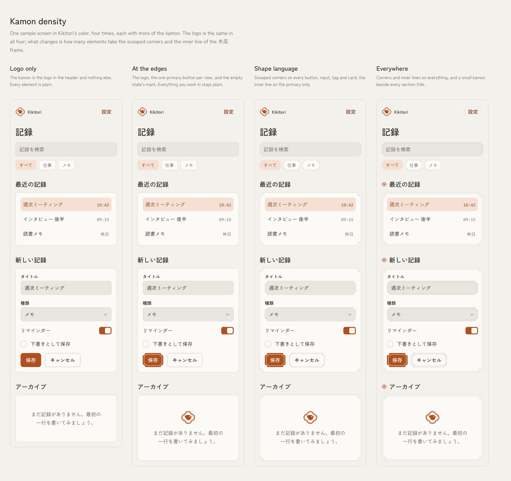
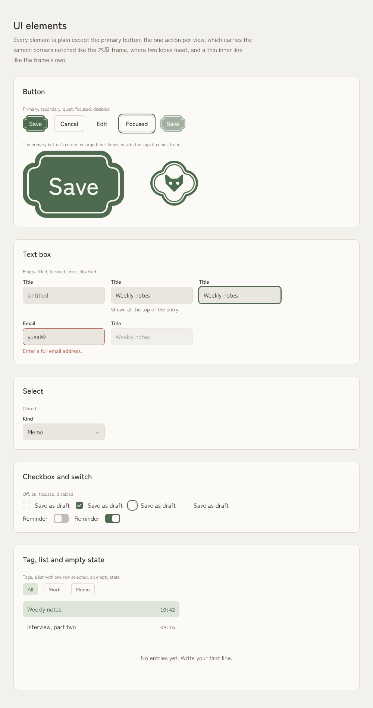

# Direction: how much of the kamon goes into UI elements

Status: superseded 2026-10-18 by `direction-double-line.md`. The notch is retired: the primary button is now the plain button with its inner line, and the kamon's double line also comes in as one frame and one rule per view. This page is the record of the notch and of the first density study, which still holds: a crest is a seal, one per view.

## The two details

The logo is the 木瓜 frame, so elements borrow two of its details rather than the whole crest:

- **The notch.** Where two of the frame's lobes meet, two outward quarter circles come together at an inward point. On a rectangle that is the outline of a wide and a tall rounded rectangle overlapping: at each corner, two small lobes and a notch between them.
- **The inner line.** A thin second line just inside the edge, following the same outline, like the frame's inner line.

## Four densities

The study put one sample screen in Kikitori's color at four densities (`docs/kamon-ui/density-light.png`, `density-dark.png`). It was drawn with the first attempt at the corner, described below.

| Density | What carries the kamon | How it reads |
|---|---|---|
| Logo only | The logo in the header | Calm and clean, but nothing but the icon says which family the app is from. |
| **At the edges (adopted)** | The logo, the one primary button per view, and the empty state's mark | The primary button reads like a seal pressed on the page: one stamp per view, on the action that matters. Everything you type into or read stays plain. |
| Shape language | The corners on every button, input, tag and card; the inner line on the primary | Cards and inputs start to look like tickets and coupons, and the primary no longer stands apart. |
| Everywhere | Corners and inner lines on everything, a small kamon beside each section title | Busy. Double lines everywhere turn into texture, and the small marks dilute the logo. |

- **A kamon is a seal, so use it like one.** A crest marks one thing. The details work where there is one of something in a view: the primary action, the logo, the empty state.
- **It matches a rule we already have.** `accent` fills at most one primary control per view, so the color and the kamon point at the same place.
- **Not on small or repeated elements.** With the corner on them, checkboxes read as plus signs and tags as price labels.

## The corner, corrected

The first attempt used CSS `corner-shape: scoop`: one concave arc cut into each corner. That is a ticket stub's corner, not the crest's, and it is a large part of why the denser screens looked like tickets (`docs/kamon-ui/scooped-elements-light.png`). The 木瓜 notch is the opposite: two convex quarter circles meeting at an inward point.

The adopted button draws that outline with `clip-path: shape()`, which follows the button at any size. Each lobe has a radius of 8px (`radius-md`): at 4px the lobes were too small to see and the button read as a clipped label, and from 10px the side lobes start to meet and the button turns into a cloud.

The inner line runs parallel to the outline, 3px inside it and 1px wide. Its lobes share the outline's centres with a smaller radius, and at each notch it curves around the notch's point in a small arc, so the strip outside it and the line itself keep one width all the way round. (A first version copied the outline at a smaller size instead: same radius, shifted centres, and a strip that pinched at the corners.) The fill and the inner line are two layers behind the label, so the focus ring is untouched and no shadow is involved. `shape()` works in current Chrome, Edge and Safari; a browser without it shows the plain primary button.

## Where it does not apply

Native controls stay native. On iOS and in Windows chrome the primary is the platform's own button tinted with `accent`; the kamon button is for the web and the brand's own desktop UI.
